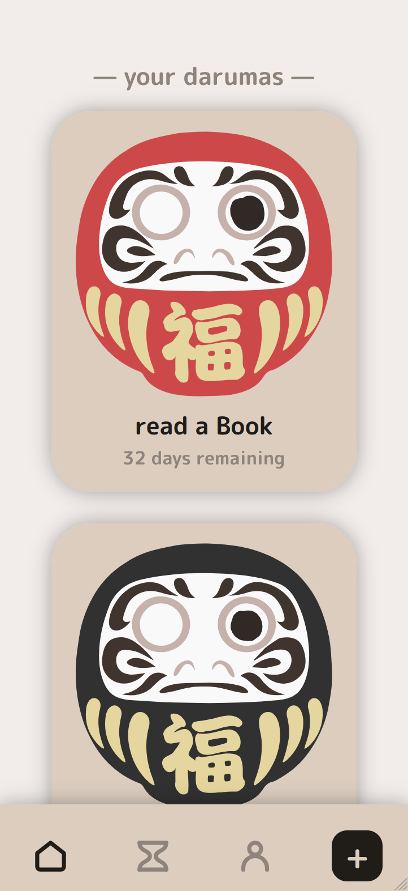
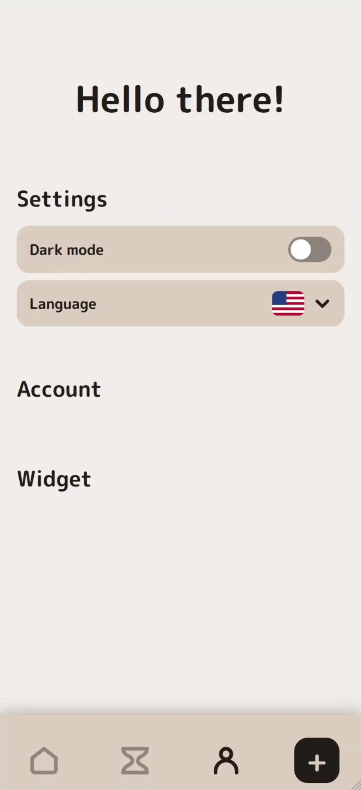

<p align="center">
  
  
</p>

# Daruma

A goal-tracking app built around the Japanese daruma doll, made with React Native and Expo.

Traditionally, when you set yourself a goal, you paint in the daruma's left eye. Once the goal is reached, you paint the right one. This app brings that ritual to your phone: pick a daruma, write down your goal, paint the first eye with your finger, and paint the second one when you've made it.

## Features

- **Create a daruma** in a few steps: pick a color (each with its traditional meaning), describe your goal, set an optional deadline and paint the left eye.
- **Complete it** by painting the right eye. Finished darumas move to your archive.
- **Deadlines**: darumas past their deadline are marked as overdue, and you can extend the deadline.
- **Dark mode** and **multiple languages**: English, German, French, Spanish and Japanese, with Chinese in progress.
- **Small animations** throughout: smooth step transitions, a wiggling daruma, and confetti when you reach a goal.

## Tech stack

- [Expo](https://expo.dev) (SDK 57) and React Native, written in TypeScript
- expo-router for navigation
- zustand and AsyncStorage for local data (everything stays on your device)
- react-native-reanimated for animations, react-native-svg for the drawing canvas
- i18next for translations

## Getting started

```bash
cd mobile
npm install
npx expo start
```

Scan the QR code with Expo Go, or press `w` to open the app in the browser.

## Roadmap

- 3D view of the daruma with a cartoon look
- Home screen widget for each daruma
- Release on the Google Play Store, with iOS to follow

## Credits

- Original daruma artwork: [Flaticon](https://www.flaticon.com/free-icon/daruma_6143324)
- Font: [M PLUS Rounded 1c](https://fonts.google.com/specimen/M+PLUS+Rounded+1c), SIL Open Font License
